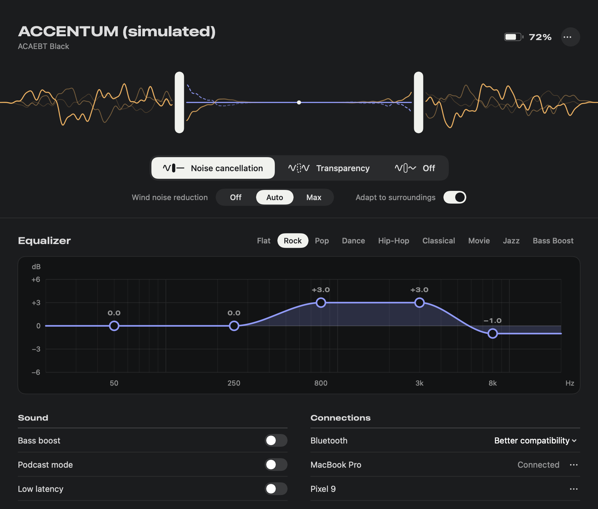
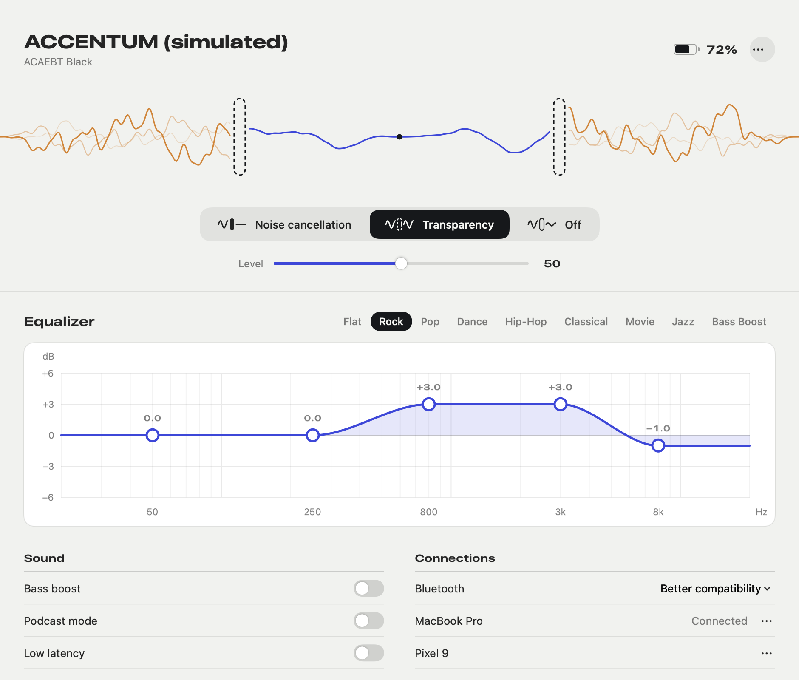
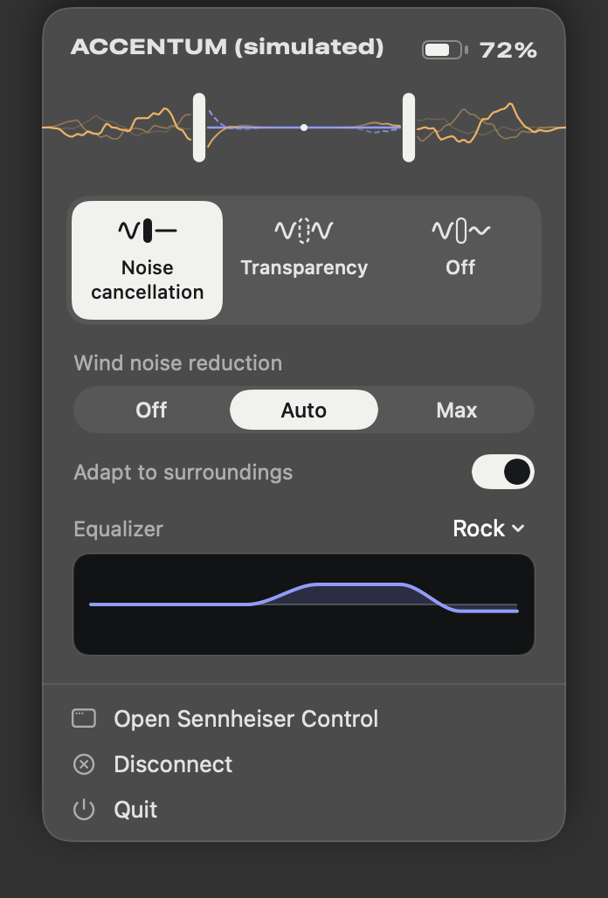

# Sennheiser Control for macOS

[](https://github.com/rohit746/sennheiser-control-mac/actions/workflows/ci.yml)

A native macOS app (SwiftUI + IOBluetooth) that talks directly to Sennheiser
headphones — no phone, no Android app. It implements the same **GAIA V3**
protocol that the *Sennheiser Smart Control Plus* Android app
(`com.sonova.chb.control`) speaks to Qualcomm/Airoha-based Sennheiser devices.

Built from the reverse-engineering notes in [`docs/PROTOCOL.md`](docs/PROTOCOL.md).





## Features

- Connect to a **paired** Sennheiser headphone over Bluetooth Classic RFCOMM
  (the "GAIA" Serial-Port record, UUID `A2129FF3-081B-4C45-8AFE-469D9C4842EC`,
  channel auto-discovered via SDP with a fallback scan)
- **Auto-connect**: the last headset that answered GAIA is remembered and
  connected at launch and whenever it reconnects to the Mac (Device ›
  Connect Automatically)
- **Menu bar panel** with battery level, the listening modes and their
  contextual control, and the equalizer preset (Sennheiser Control › Show in
  Menu Bar); the app keeps running in the menu bar when the window is closed.
  A miniature of the sound stage shows the current mode (and searches while
  connecting), the card resizes smoothly between modes, and its sections and
  EQ curve animate in each time it opens (all motion respects Reduce Motion)

  
- **Sound stage**: a live cross-section of the headphones across the top of
  the window. Outside sound travels in from both sides to the ear cups; noise
  cancellation meets it with its mirror image and leaves a flat line,
  transparency plays it on at the level you set, and with noise control off a
  muffled remainder leaks through
- **Noise control**: ANC on/off, Transparency on/off, transparency level 0–100,
  anti-wind mode, adaptive ANC (MOMENTUM 4 combined-mode property)
- **Battery** with live notifications (%)
- **Equalizer**: 5-band graphic EQ (50 / 250 / 800 / 3k / 8k Hz, ±6 dB) with
  presets, plus Bass Boost
- **Device info**: model, firmware, serial, HW revision, active codec
- **Features**: Smart Pause, On-Head Detection, Auto Answer, Comfort Call,
  Low Latency, Podcast mode, Bluetooth compatibility, Sidetone, voice-prompt
  mode & language, auto power-off timer
- **Paired-device management** (connect / disconnect / unpair the headset's own
  pairing list)
- **GAIA frame log** (View › Show Frame Log, ⌘L) with decoded command names and
  a **raw frame sender** for further experimentation

Every setting is applied optimistically, then read back from the headset, so
the UI always ends up showing what the device actually accepted. Controls the
headset does not report are shown disabled.

## Design

The interface is ink on chalk in light mode and chalk on carbon in dark mode.
Colour is kept for sound: amber is sound from outside, blue-violet is what the
headphones play, so the equalizer curve and the level sliders are blue-violet
and nothing else is. Names and headings are set in SF Pro Expanded.

## Install

Download `SennheiserControl.zip` from the
[latest release](https://github.com/rohit746/sennheiser-control-mac/releases/latest),
unzip it and move `SennheiserControl.app` to Applications.

The build is ad-hoc signed and not notarized, so macOS blocks it the first time.
Either allow it in System Settings › Privacy & Security › Open Anyway, or clear
the quarantine flag:

```sh
xattr -dr com.apple.quarantine /Applications/SennheiserControl.app
```

Pair the headphones with the Mac in Bluetooth Settings first. On first launch
macOS asks for Bluetooth permission.

## Build

```sh
swift build          # debug build
swift test           # codec + session tests (45), no hardware needed
./.build/debug/SennheiserControl --selftest   # wire-format self test

bash scripts/make-app.sh
open build/SennheiserControl.app
```

Requires macOS 13+, Xcode/Swift toolchain. The app is ad-hoc signed; on first
run macOS asks for Bluetooth permission.

## CLI modes

```sh
SennheiserControl --selftest   # validate GAIA frame codec against known vectors
SennheiserControl --services   # dump SDP records + RFCOMM channels of paired devices
SennheiserControl --probe      # connect to the first paired Sennheiser device,
                               # print model/firmware/battery/ANC/EQ and frame log
                               # (read-only: GETs and notification subscriptions)
SennheiserControl --demo       # run the full UI against a simulated headset
                               # (add --open-panel to open the menu bar panel at launch)
SennheiserControl --snapshot out.png [--dark|--light] [--disconnected|--connecting] [--mode transparency] [--panel] [--size 940x800]
                               # render the UI (simulated headset) to a PNG
```

If `--probe` stalls at "Opening RFCOMM channel" (seen when the bare binary is
started from a sandboxed shell), run it through the app bundle instead:

```sh
open -W --stdout probe.log build/SennheiserControl.app --args --probe
```

## Protocol summary (GAIA V3, Sennheiser vendor 0x0495)

```
FF | 03 | len_hi len_lo (BE) | vendor_hi vendor_lo (BE) | cmd_hi cmd_lo (BE) | payload
```

Responses use `cmd | 0x0100`, notifications `cmd | 0x0080`, errors `| 0x0180`.
Requests are sent one at a time: the next one goes out when the response or
error for the previous one arrives (or after 0.5 s). Queued writes to the same
setting are coalesced, so dragging a slider only ever sends the latest value.
Notification subscription: `0x0007` + feature id (battery=3, userEQ=8,
transparentHearing=12, ANC=13). Full command catalog in
[`docs/PROTOCOL.md`](docs/PROTOCOL.md).

## Project layout

```
Sources/GAIA3/
    GAIA3.swift                        frame codec + command catalog + models
    DeviceState.swift                  device state, updated from response frames
Sources/SennheiserControl/
    HeadphoneSession.swift             request queue, controls, auto-connect
    Transport.swift                    transport / device-directory protocols
    RFCOMMTransport.swift              IOBluetooth: SDP, channel scan, RFCOMM I/O
    SimulatedHeadset.swift             in-memory headset for --demo and tests
    Views.swift                        SwiftUI window: stage, listening modes, settings
    Theme.swift                        palette, type, motion, shared controls
    SoundStage.swift                   animated cross-section of the headphones, mode pictograms
    EqualizerGraph.swift               draggable response curve and its mini version
    MenuPanel.swift                    menu bar item and its animated panel
    AppDelegate.swift                  window and main menu
    main.swift                         app bootstrap + CLI modes
Tests/GAIA3Tests/                      codec tests with known-good frame vectors
Tests/SennheiserControlTests/          session tests against the simulated headset
scripts/make-app.sh                    builds the .app bundle (and its icon)
docs/PROTOCOL.md                       reverse-engineering notes and command catalog
```

## Limitations / unknowns

- **Verified live against a real ACCENTUM**: GAIA link on
  RFCOMM channel 15, reads back model `ACAEBT Black`, firmware `3.34.0`,
  serial, battery %, ANC/transparency state, anti-wind/adaptive flags, EQ
  config (5 bands, ±6 dB), prompt/timer/toggle states and the paired-device
  list. Write paths (setters) are implemented but take care on real hardware.
- **Read path re-verified live on 2026-10-13** (ACCENTUM, firmware 3.34.0) with
  the request queue and the split RFCOMM transport: 37 requests, every one
  answered, no errors or timeouts. Confirmed on hardware: EQ config replies as
  `0x1100`, notification registrations are acknowledged (`0x0107`), and the
  auto power-off timer is in **seconds** (`0x0384` = 15 min).
- **Still not exercised on hardware:** every setter, auto-connect on a
  reconnect event, and the menu bar item against a real link.
- `GET EQ band` (`0x1002`) answers with a single byte on this firmware, not
  `[index, gain]`; its meaning is unconfirmed (the EQ was flat), so it is
  ignored and band gains are taken from the `0x1082` notification.
- Audio mode reads `00 01` on the ACCENTUM. Only `2` (podcast) is understood;
  turning Podcast Mode off restores whatever mode was read before.
- **BLE-only models** (GATT services `8769C9B6-…` / `A2129FF3-…`) are not
  implemented: the characteristic pair hosting GAIA on those services is still
  unknown (see report, "Remaining unknowns").
- Semantics of the `E290DE85-…` / `63331338-…` UUID families are unresolved.
- Parametric EQ (commands `0x100A–0x1013`) is not exposed yet.

## Credits

Protocol knowledge was assembled from REA analysis of the real APK
([`docs/PROTOCOL.md`](docs/PROTOCOL.md)) and cross-checked against these community projects:

- [Oein/sennheiser-desktop-client](https://github.com/Oein/sennheiser-desktop-client)
  — `PROTOCOL.md` (frame format, command catalog, verified captures)
- [momentumctl](https://git.sr.ht/~gjabell/momentumctl) — Rust CLI, MOMENTUM 4
- [Loris383v/accentum-plus-control](https://github.com/Loris383v/accentum-plus-control)
  — ACCENTUM Plus, GAIA-over-RFCOMM notes

This app is an independent implementation and is not affiliated with Sennheiser
or Sonova.

## License

[MIT](LICENSE)
